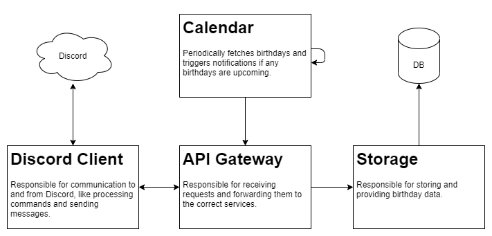

# BirthdayBot
[](https://github.com/Ionaru/birthday-bot/actions/workflows/cd.yml)

## General information
BirthdayBot is a Discord bot that keeps track of birthdays per channel and announces
them when they come round.

It posts four times for every birthday: two weeks before, one week before, the day
before, and on the day itself. The check runs once a day at 18:00 UTC.

## Usage
BirthdayBot uses Discord slash commands. Registered birthdays belong to the channel
they were added in, so the same person can be tracked in several channels
independently.

| Command | Description |
| --- | --- |
| `/info` | Show information about the bot. |
| `/add-birthday <user> <day> <month> [year]` | Add a birthday to this channel. |
| `/remove-birthday <user>` | Remove a birthday from this channel. |
| `/list-birthdays` | List the birthdays registered in this channel. |

The `year` option is optional and is never shown; only the day and month are used.
Leaving it out is fine.

### Discord permissions
BirthdayBot needs three permissions in the channels it posts to:

* `View Channel`
  * To see the channel it was told to announce in.
* `Send Messages`
  * To post the announcements.
* `Mention @everyone, @here and All Roles`
  * The announcements start with `@here`.

BirthdayBot uses no privileged gateway intents, so `Presence`, `Server Members` and
`Message Content` can all stay switched off. It resolves the names it needs one user
at a time over the REST API rather than fetching the whole member list.

## Architecture
BirthdayBot is separated into 4 services, each with their own role and
responsibilities.



| Service | Role |
| --- | --- |
| `api` | Gateway. Forwards to `storage` and `discord-client`; the only service the others call. |
| `calendar` | Fires the daily check and asks for the notifications that are due. |
| `discord-client` | The Discord connection, the slash commands, and the notification webhook. |
| `storage` | Owns the SQLite database. |

They are published as four separate images and reach each other by Compose service
name on a private network. Nothing is published to the host.

The repository is a pnpm workspace, split so that the distinction is visible in the
directory tree:

```
apps/   one runnable service per directory, one Docker image each
libs/   shared code, imported by the apps, never an image of its own
```

| Package | Location | Runtime dependencies |
| --- | --- | --- |
| `@birthday-bot/api` | `apps/api` | none |
| `@birthday-bot/calendar` | `apps/calendar` | none |
| `@birthday-bot/discord-client` | `apps/discord-client` | `discord.js` |
| `@birthday-bot/storage` | `apps/storage` | none |
| `@birthday-bot/common` | `libs/common` | none |
| `@birthday-bot/interfaces` | `libs/interfaces` | none |

## Self-hosting
It is possible to self-host this bot. It requires Docker with the Compose v2 plugin.

### Step one: Creating a bot user
1. Go to [https://discord.com/developers/applications](https://discord.com/developers/applications) and create a new application.
2. On **General Information**, copy the **Application ID** (`BIRTHDAYBOT_ID`).
3. Go to **Bot**, then **Reset Token**, and copy the token (`BIRTHDAYBOT_TOKEN`). Discord only shows it once.
4. Leave every **Privileged Gateway Intent** switched off, BirthdayBot does not use any.
5. Under **OAuth2 > URL Generator**, select the `bot` and `applications.commands` scopes, and the
   `View Channel`, `Send Messages` and `Mention @everyone, @here and All Roles` bot permissions.
6. Open the generated URL in your browser and add the bot to your server.

### Step two: Installing the bot
1. Install [Docker Engine](https://docs.docker.com/engine/install/), which includes the Compose v2 plugin.
2. Clone this repository, or [download](https://github.com/Ionaru/birthday-bot/archive/main.zip) and extract it.
3. Create a `.env` file in the root of the checkout:

   ```dotenv
   BIRTHDAYBOT_ID=your_application_id
   BIRTHDAYBOT_TOKEN=your_bot_token

   # Optional, see the table below.
   BIRTHDAYBOT_DATA_VOLUME=/absolute/path/to/your/data
   ```

4. Start the bot:

   ```bash
   docker compose --project-name birthday-bot --env-file "$PWD/.env" --file deploy/compose.yaml up -d
   ```

   The `--env-file` flag is not optional. The Compose file lives in `deploy/`, so Compose looks for a
   `.env` next to it and will **not** find the one in the root of the checkout. Without the flag the
   bot starts with no credentials and writes its database somewhere you did not intend.

5. Check that it came up:

   ```bash
   docker compose --project-name birthday-bot --env-file "$PWD/.env" --file deploy/compose.yaml logs -f
   ```

Run `docker compose ... config` instead of `up` at any point to print the fully resolved
configuration. That is the quickest way to confirm your credentials, image tags and data directory
are what you expect.

### Environment variables

| Variable | Required | Description |
| --- | --- | --- |
| `BIRTHDAYBOT_TOKEN` | Yes | The Discord bot token. |
| `BIRTHDAYBOT_ID` | Yes | The Discord application ID. |
| `BIRTHDAYBOT_GUILDS` | No | Comma-separated guild IDs to register the commands in. Unset registers them globally. |
| `BIRTHDAYBOT_DATA_VOLUME` | No | Where BirthdayBot keeps its database. Defaults to a Docker named volume. |
| `BIRTHDAYBOT_GIT_REVISION` | No | Image tag to run. Defaults to `latest`. |
| `DEBUG` | No | Set to `birthday-bot*` or `*` for extra logging output. |

The storage service keeps a SQLite database (`birthday.db`) in `/app/data` inside its
container. `BIRTHDAYBOT_DATA_VOLUME` must be either left unset, which uses the named
volume declared in the Compose file, or set to an **absolute** host path. A relative
path such as `./data` resolves against `deploy/`, not the root of the checkout.

You do not need to prepare that directory. The services run as an unprivileged user,
and Docker creates a missing bind-mount source owned by `root`, so the container takes
ownership of `/app/data` on startup before dropping privileges. That also covers
upgrading from a pre-2026 deployment, whose `birthday.db` was written by a container
running as root.

Commands registered globally can take up to an hour to appear in a server for the first
time. Setting `BIRTHDAYBOT_GUILDS` registers them in those servers immediately, which is
useful while developing.

Seven more variables exist for deployments that are not this Compose file. They all
have working defaults, so a Compose deployment never needs to set any of them:

| Variable | Default | Description |
| --- | --- | --- |
| `BIRTHDAYBOT_API_URL` | `http://api:3000` | Where `calendar` and `discord-client` reach the gateway. |
| `BIRTHDAYBOT_STORAGE_URL` | `http://storage:3000` | Where the gateway reaches `storage`. |
| `BIRTHDAYBOT_DISCORD_CLIENT_URL` | `http://discord-client:3000` | Where the gateway reaches `discord-client`. |
| `BIRTHDAYBOT_API_PORT` | `3000` | The port `api` listens on. |
| `BIRTHDAYBOT_STORAGE_PORT` | `3000` | The port `storage` listens on. |
| `BIRTHDAYBOT_DISCORD_CLIENT_PORT` | `3000` | The port `discord-client` listens on. |
| `BIRTHDAYBOT_DB_PATH` | `data/birthday.db` | Where `storage` keeps the database, inside its container. |

### A note on architecture
The prebuilt `ghcr.io/ionaru/birthday-bot-*` images are `linux/amd64` only. On other
architectures the pull fails with a manifest error, and you will need to build the
images locally instead:

```bash
docker compose --project-name birthday-bot --env-file "$PWD/.env" --file deploy/compose.yaml up -d --build
```

## Feature requests
Please open an [issue](https://github.com/Ionaru/birthday-bot/issues/new) if you have any feature ideas for this bot
or are missing any functionality.

## Developer information
Want to contribute? Awesome! See [CONTRIBUTING.md](CONTRIBUTING.md) to get started.

BirthdayBot is written in TypeScript and requires **Node.js 24 or newer**. There is no
build step: Node runs the TypeScript in `apps/*/src` and `libs/*/src` directly,
stripping the types as it loads. `tsc` is only ever used to typecheck.

```bash
corepack enable    # pnpm comes from the "packageManager" field
pnpm install       # Install dependencies
pnpm run check     # Lint, typecheck and test
pnpm run test      # Just the tests
```

To run one service outside Docker:

```bash
node apps/storage/src/index.ts
```

`discord.js` is the only runtime dependency in the whole repository. Everything else is
a Node built-in: `node:sqlite` for the database, `node:http` for the three servers,
`fetch` between them, and `Intl` for the dates.
